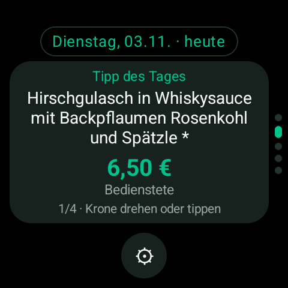
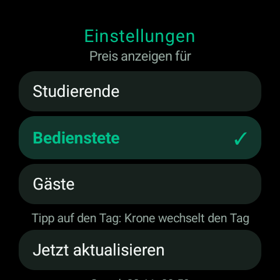

# 🍽️ MensaPlan

MensaPlan is a standalone **Wear OS** app that puts the daily canteen menu right on your wrist. It fetches the weekly meal plan from the [KIT cafeteria website](https://cga.se4.kit.edu/speiseplan/weekly/menu-de.html), caches it on the watch, and shows it in three places:

- 📱 **The app** – a pager of weekdays, one dish at a time, navigated with the crown
- 🔲 **A home-screen Tile** – today's menu at a glance
- ⏱️ **A watchface complication** – the current price of your selected dish

No phone app required — the app is fully standalone (Wear OS 3+ / API 30+).

---

## 📸 Screenshots

| Meal plan | Settings |
|:---:|:---:|
|  |  |

---

## ✨ Features

- **Weekly meal plan** – fetched from the KIT canteen, cached for offline use (30-minute freshness window)
- **Rotary crown navigation** – rotate the crown to flip through the dishes of the day, or tap the day pill to switch days with the crown
- **Swipe between days** – a vertical pager with a discreet dot indicator on the round display edge
- **Price categories** – choose between *Studierende* (student), *Bedienstete* (staff) and *Gäste* (guest) prices
- **Dish details** – category, description (auto-shrinking text), price and position counter (e.g. `2/3 · Krone drehen oder tippen`)
- **Home-screen Tile** – shows today's menu; tap to open the app
- **Watchface complication** – *SHORT_TEXT* complication showing the price, updated hourly
- **German UI**, round-display optimized, dark theme with a mint accent

---

## 🚀 Getting started

1. Open the project in **Android Studio** (Jellyfish or newer).
2. Connect a Wear OS watch (or start an emulator) and select it as the run target.
3. Press **Run ▶** to build and deploy the `:app` module.

From the command line:

```bash
# Build & install the debug APK
./gradlew :app:installDebug
```

---

## 🔧 Tech stack

- **Kotlin** 2.2 + **Jetpack Compose** (Wear Compose Material3)
- **AGP** 9.5, `compileSdk`/`targetSdk` 37, `minSdk` 30
- **Wear Tiles** (Protolayout) for the home-screen tile — `androidx.wear.tiles`
- **Watchface Complications** (`SHORT_TEXT`) for the price complication — `androidx.wear.watchface`
- **No third-party networking** – plain `HttpURLConnection` + custom HTML parsing

---

## 📁 Project structure

```
app/src/main/java/com/watchyourself/mensaplan/
├── complication/    MainComplicationService – SHORT_TEXT price complication
├── data/
│   ├── MensaModels.kt      Dish, MensaDay, MensaWeek, MensaPlan, PriceCategory
│   ├── MensaParser.kt      Extracts & parses the meal plan from the KIT website
│   ├── MensaRepository.kt  Download + cache (SharedPreferences, 30 min TTL)
│   └── MensaSettings.kt    Persisted settings (price category)
├── presentation/
│   ├── MainActivity.kt     Wear Compose entry point
│   ├── MensaApp.kt         Plan screen, settings screen, rotary handling
│   └── theme/Theme.kt      Dark theme + mint accent
└── tile/               MainTileService – home-screen tile
```

---

## 📄 License

Private project. All rights reserved.
